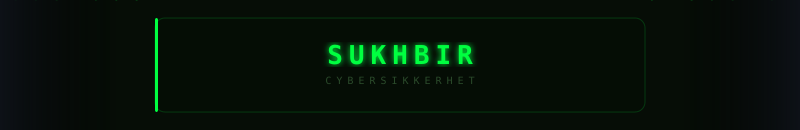

<div align="center">



</div>

---

## Hei

Jeg har alltid vært den som graver til jeg forstår hvordan ting fungerer, og hvor de kan svikte. Her deler jeg det jeg har lært om cybersikkerhet, slik at flere kan komme i gang.

```
$ whoami
sukhbir

$ cat interesser.txt
penetrasjonstesting
sårbarhetsanalyse
SIEM og logganalyse
hendelseshåndtering
IoT og OT
Linux
```

---

## Det jeg jobber med

| Område | Verktøy og temaer |
|---|---|
| **Sikkerhetstesting** | Kali Linux, Burp Suite, OWASP ZAP, Metasploit, Nmap, Wireshark, MobSF, Frida, Objection, jadx-gui, Volatility 3, manuell kodegjennomgang |
| **SIEM og analyse** | Splunk, logganalyse, trusseldeteksjon, hendelseshåndtering |
| **Sky og plattformer** | AWS, Azure, VMware, VirtualBox, Linux, OpenCTI |
| **Programmering** | Python, Bash, JavaScript, MySQL, HTML og CSS, Git |
| **Rammeverk** | OWASP, MITRE ATT&CK, NIST SP 800-115, ISO 27001, NSMs Grunnprinsipper |

---

## Prosjekter

**Penetrasjonstest av en webapplikasjon (bachelorprosjekt, 2025)**
Manuell test av en reell webapplikasjon for en oppstartsbedrift, etter OWASP WSTG og NIST SP 800-115. Funnene lå innen tilgangskontroll, sikkerhetskonfigurasjon og databeskyttelse, og endte i en rapport med CVSS-vurdering, risikoanalyse og anbefalte tiltak. Verktøy: Burp Suite, Nmap, ffuf og manuell kodegjennomgang. Detaljer og funn er taushetsbelagt.

**Grafisk grensesnitt for Volatility 3 (teamprosjekt, 2024)**
Moderne GUI for minneforensikkverktøyet Volatility 3, laget i samarbeid med et sikkerhetsselskap. Jeg hadde en sentral rolle i ideutvikling, design, prototyping og prosjektledelse.

---

## Kurs

| Kurs | Tilbyder | Tidspunkt |
|---|---|---|
| Practical Ethical Hacking | TCM Security | jan. til feb. 2025 |
| Security Operations (SOC) 101 | TCM Security | jan. til feb. 2025 |
| Practical Bug Bounty | TCM Security | mar. til mai 2025 |
| OSCP+ forberedelseskurs (Red Team) | Udemy | okt. 2025 |
| AI: Risk and Cyber Security | Udemy | juli til aug. 2024 |

---

## Kom i gang selv

En vei inn i faget som er lett å følge. Øv alltid bare på systemer du har lov til å teste.

1. **Grunnlaget:** lær Linux og nettverk først. Alt annet bygger på det.
2. **Forstå angrep:** [Practical Ethical Hacking](https://academy.tcm-sec.com) er et godt sted å begynne.
3. **Øv lovlig:** [OWASP Juice Shop](https://owasp.org/www-project-juice-shop/), [PortSwigger Web Security Academy](https://portswigger.net/web-security) og [Hack The Box](https://www.hackthebox.com).
4. **Lær å se angrep:** bruk [MITRE ATT&CK](https://attack.mitre.org) som kart, og prøv en SIEM som Splunk.
5. **Forstå rammeverkene:** [NIST CSF 2.0](https://www.nist.gov/cyberframework), [OWASP WSTG](https://owasp.org/www-project-web-security-testing-guide/) og [NSM](https://nsm.no).

---

## Cybersikkerhetsquiz

Test deg selv med 40 spørsmål fordelt på fem områder: GRC og regelverk, NIST CSF 2.0, OT og IoT, SOC og deteksjon, og sky og teknisk sikkerhet. Hvert svar har en kort forklaring.

<div align="center">

[](https://speed-boo3.github.io/cybersecurity-quiz/)

</div>

Kildekoden er ren HTML, CSS og JavaScript. Se [cybersecurity-quiz](https://github.com/Speed-boo3/cybersecurity-quiz).

---

**Språk:** norsk (flytende), engelsk (flytende), punjabi (morsmål)

<div align="center">

</div>
